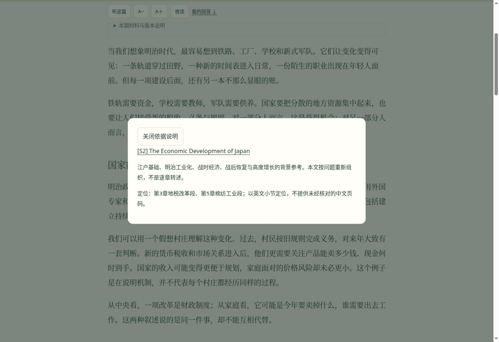

# 阅读系统V4：继续完成可执行的整改

日期：2026-10-24。基于V3提交`8e0f40f`。

本轮没有停在三篇样板：向同类型材料扩展编修，并补上恢复流程的缺口。下列完成指实际代码、正文和验证产物；不把时间尚未发生的观察或未持有的设备写成通过。

## 按原计划交付

| 计划项 | 本轮具体结果 | 验证依据 |
|---|---|---|
| 样板向其它材料迁移 | 34篇旧正文与追加深读按因果顺序合编，移除中途预告，保留推演、反例与边界；额外练习折叠 | 统一源与生成正文；校验拒绝遗留的depth-study拼接块 |
| 文学材料保持独特性 | 土星之环六处通用软件类比改为观看、档案、叙述距离与记录伦理；第5、7期加入限定到正版试读开篇的细读 | 英文试读印刷第3～4页，按页渲染核对；未重印原文与图像，不冒称全书细读 |
| 工程学习可以动手 | Agent其余11期补独立开场；12期均有环境、命令、输入、预期、边界与可修改任务 | 三份Python标准库脚本；12组实验实际运行 |
| MCP接入有实际结果 | 第10期启动真实本地stdio教学服务，初始化、通知、工具发现、调用、结果相关和工具错误逐项检查 | 子进程通讯轨迹；固定2025-11-25协议子集，不作完整MCP兼容认证 |
| 论证与材料可回查 | 全83单元有具体论证路线、反例及资料范围；日本史遗漏的S编号资料补入本期，并为第1、2、5期缩小章节定位 | content/editorial-review.json；所有数字引用可定位；详见CONTENT_REVIEW.md |
| 一个自己的问题 | 崩盘八期由共用提示改为各自机制的情境问题；旧页面中的额外回答练习变为可选区 | 每辑问题不得重复，回答仍由统一阅读器维护 |
| 口播是一条正文 | 参考资料、方法说明、实验与可选练习不进入正文稿；估时按干净正文计算，工程实验另计 | 83份下载稿的资料区排除检查 |
| 导入可撤回 | 文件、文本共用合并逻辑；确认改为可阅读弹层；恢复前再留一份本地记录，并可导出 | 浏览器完成文本导入→确认→撤回→确认→0回答恢复；备份文本显示核对为空记录 |
| 存储错误不覆盖记录 | 先写恢复点，再写当前记录，任何一步失败不报告成功 | 两项新增Node测试覆盖恢复点写失败、主记录写失败、导入与恢复的两份独立快照 |
| 无语音环境仍能取稿 | 下载稿链接先于语音引擎检测创建；恢复位置排除隐藏练习 | 实现检查；没有伪称中文声音与手机锁屏已通过 |

## 实验边界

这些实验主要验证基础设施机制，不是模型排行榜。第2期使用给定required列表的确定性策略；第5期以精确夹具判支持，不是通用语义蕴含。第7期的内存幂等示意不保证生产环境原子持久性。第10期有真实本地进程和消息，但不包含认证或全部协议能力。第11期的协作者为模拟。没有测真实模型成功率、token费用、网络延迟。

## 验证命令

```text
python3 scripts/build-reading-system.py
node --test tests/*.test.cjs
python3 scripts/validate-reading-content.py
python3 site/downloads/agent-control-experiment.py
python3 site/downloads/agent-reading-labs.py --all
```

本地通过26项Node测试、83期永久ID与引用/正文稿校验、12期实验；发布工作流执行同一组检查。新增的12期实验中，第2期另包含原先10个共同预算任务。确定性夹具通过只说明这些检查通过。

浏览器已观察：文本备份合并与撤回成功、恢复后的备份文本、日本史材料弹层的具体定位、Agent实验与三份下载入口、正文与实验时长分列。资料弹层截图如下。



## 尚未验收与条件分支

- 文件选择器在云端验收接口再次超时。没有将“按钮已点击”写成文件导入成功；文本导入使用同一数据逻辑并已实测。后续不再重复等待该环境问题。
- 实际中文发声、iOS/Android锁屏与后台连续播放，需要实际设备；本轮没有该设备的验收证据。
- 两周真实使用尚未发生，无法用短时自动测试代替。可使用V3中的每周一次观察模板，不增加打卡要求。
- 云同步和预生成音频是原计划明确的条件分支：观察确有需要后另行评估。本轮不擅自增加账号、服务费用或公开个人回答。
- 全83篇有论证与边界记录，34篇完成连贯合编，Agent11篇补开场及12期配套实验；不声称83篇全部重写，也不把出版社介绍、目录、研究摘要等同于原著全文核读。

工程与当前可实施材料编修已交付；实机与真实使用验收必须继续保持“未验收”，不能用发布成功替代。
